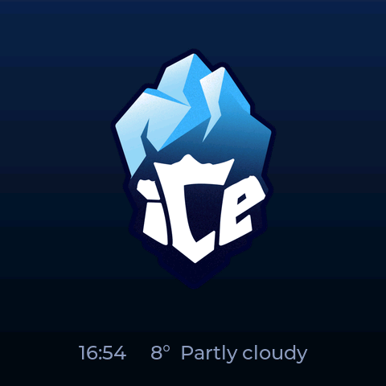
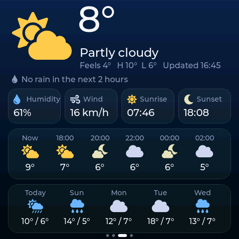
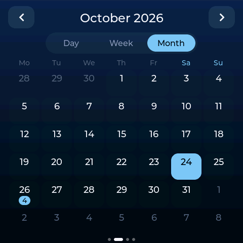
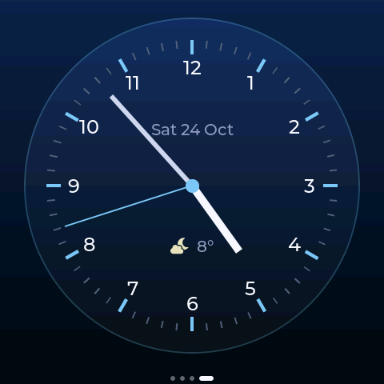

# Wall Panel

A kitchen/hall wall panel for the **Guition ESP32-S3-4848S040**, a 4" 480x480 touch screen in an 86-box wall plate. It shows the time, weather with rain alerts, your Google Calendar, daily horoscopes and an analog clock, and switches to a logo screen when idle and to night mode after dark.

Built with PlatformIO (Arduino framework), LVGL 8.3 and moononournation's GFX Library for Arduino.

| Idle | Weather | Calendar | Clock |
|---|---|---|---|
|  |  |  |  |

## Hardware

**Board:** Guition **ESP32-S3-4848S040**, also sold as "ESP32-4848S040" or a "4.0 inch 86 box" ESP32-S3 smart display. Check that your board matches the specs below. This project was built and tested on one unit with the CH340 USB bridge.

| Part | Details |
|---|---|
| MCU | ESP32-S3 (dual core, 240 MHz, Wi-Fi 2.4 GHz + BLE 5) |
| Memory | 16 MB flash, 8 MB octal PSRAM (ESP32-S3R8 / N16R8) |
| Display | 4.0" IPS, 480x480, ST7701S driver, 16-bit RGB parallel interface |
| Touch | GT911 capacitive, I2C address 0x5D |
| USB | USB-C through a CH340 USB-UART bridge (shows up as a COM port, VID 1A86:7523) |
| Power | 5 V over USB-C |

The only Wi-Fi is 2.4 GHz; 5 GHz-only networks are not visible to the panel.

### Pins

| Function | GPIO |
|---|---|
| ST7701 init (3-wire SPI) | CS 39, SCK 48, MOSI 47 |
| RGB control | DE 18, VSYNC 17, HSYNC 16, PCLK 21 |
| RGB red (R0-R4) | 11, 12, 13, 14, 0 |
| RGB green (G0-G5) | 8, 20, 3, 46, 9, 10 |
| RGB blue (B0-B4) | 4, 5, 6, 7, 15 |
| Backlight (PWM) | 38 |
| Touch I2C (GT911) | SDA 19, SCL 45 |

The display pins and the ST7701 init sequence (`st7701_type9_init_operations`) come from the GFX Library's `ESP32_4848S040_86BOX_GUITION` device definition. Panel timing: HSYNC 10/8/50 and VSYNC 10/8/20 (front porch / pulse / back porch), both polarities 1.

## Features

- **Startup screen:** the logo with a spinner and progress ("Connecting to...", "Getting the time...", "Loading weather...", "Loading calendar...") until everything is loaded, so Home never shows placeholders. It gives up waiting after 30 seconds.
- **Wi-Fi setup on the touch screen:** scan, pick a network, type the password on the on-screen keyboard. The network is saved on the device and rejoined after every reboot. "Other network..." covers hidden networks. The gear icon on Home reopens it.
- **Automatic location and time zone** from the public IP (ip-api.com), so nothing has to be typed in.
- **Home:** large clock, current weather, and the next 5 calendar events of the week. Bin collections get a bin icon.
- **Calendar:** Day, Week and Month views (weeks start on Monday) with an event count on each day; tap a day to see its events. Google Calendar is read through a small Apps Script in your own account (see below).
- **Weather** from Open-Meteo (no API key): current conditions, humidity, wind, sunrise and sunset, every 2 hours for 12 hours, 5 days, refreshed every 5 minutes. A rain-in-X-minutes warning uses the 15-minute forecast. Tap the temperature to refresh.
- **Horoscope:** today's reading for one or more signs, chosen on the settings page.
- **Analog clock** with the date and current weather.
- **Idle logo screen:** after 90 seconds without a touch during the day, the panel fades to the logo (with a small time and weather line). Only a tap or a notification wakes it.
- **Notifications:** a banner for an event starting within 10 minutes, rain within 30 minutes, and bins the evening before (from 18:00) and the morning of (from 07:00).
- **Night mode:** from sunset or 20:30, whichever is earlier, until 06:30 (configurable). The screen stays off; a tap wakes it dimmed for 30 seconds and that tap is not passed on to the UI. Notifications don't switch the screen on at night.
- **Settings web page** at `http://<panel-ip>/` (the address is shown on the Wi-Fi screen): calendar feed URL, horoscope signs, scene URL, and night mode times.
- **Accented text:** the UI fonts include Latin-1 and Latin Extended-A (German, Romanian and most European languages).

## Build and flash

Requirements: [PlatformIO Core](https://platformio.org/install/cli) (or the VS Code extension) and Python.

1. Connect the panel over USB-C and find its COM port (CH340).
2. Set `upload_port` and `monitor_port` in [platformio.ini](platformio.ini) to that port (it is `COM5` in this repo).
3. Build and flash:

   ```bash
   pio run -t upload
   ```

   If `pio` is not on your PATH, use `python -m platformio run -t upload`.

The upload runs at 460800 baud. The CH340 on these boards gives `Invalid SLIP escape` errors at 921600.

On first boot, the panel opens the Wi-Fi screen. After it connects, it finds its location and time zone, then loads the weather.

### Optional: compile-time settings

[include/secrets.h.example](include/secrets.h.example) lists optional settings: fallback Wi-Fi used only when nothing is saved on the device, and a default scene URL. Copy it to `include/secrets.h`, which is gitignored. Normally you don't need it.

## Google Calendar

Google Calendar has no simple link that gives a device your events, so a small Google Apps Script in your account serves them as JSON. It reads every calendar that is ticked in Google Calendar and covers 10 weeks, from the Monday before the 1st of the current month, so the month view is complete. Recurring events are already expanded.

1. Go to [script.google.com](https://script.google.com) and click **New project**.
2. Paste in [tools/calendar-feed.gs](tools/calendar-feed.gs).
3. Change `TOKEN` to a long random string of your own.
4. Click **Deploy → New deployment → Web app**, with **Execute as: Me** and **Who has access: Anyone**.
5. Authorize it. Google warns that the app is unverified because it is your own script: click **Advanced → Go to (project name) → Allow**.
6. Copy the web app URL (it ends in `/exec`) and add `?token=<your TOKEN>` to the end.
7. Paste the result into the calendar field on the panel's settings page and save.

After changing the script, deploy it again with **Manage deployments → Edit → Version: New version**.

If something is wrong, the settings page says what: an HTML page instead of events (wrong URL, or access not set to Anyone), a wrong token, or an HTTP error.

**Privacy:** anyone with the URL and token can read your event titles and times for that 10-week window (read-only). To revoke it, change `TOKEN` and redeploy, or remove the script's access at [myaccount.google.com/permissions](https://myaccount.google.com/permissions).

## Security notes

- Calendar and horoscope requests use HTTPS, but the panel does not check server certificates yet (`WiFiClientSecure::setInsecure()`). Someone in control of your network could read the calendar token.
- The settings page has no password. Anyone on your Wi-Fi can change the settings, but the page never shows the saved calendar URL.
- Wi-Fi credentials and settings are stored unencrypted in the ESP32's NVS flash, so anyone with physical access can read them.

## Serial debug commands

Over the USB serial port at 115200 baud:

| Command | What it does |
|---|---|
| `shot` | Dumps the framebuffer (480x480 RGB565) |
| `page N` | Switches to page N (0 Home, 1 Calendar, 2 Weather, 3 Horoscope, 4 Clock) |
| `idle` | Shows the idle logo screen |

[tools/screenshot.py](tools/screenshot.py) wraps this and saves a PNG without resetting the board (it opens the port with DTR/RTS held low):

```bash
python tools/screenshot.py COM5 home.png "page 0"
```

It needs `pyserial` and `pillow`, and takes about 40 seconds per screenshot at 115200 baud.

## Project layout

| Path | Contents |
|---|---|
| [src/main.cpp](src/main.cpp) | Display and touch setup, LVGL loop, serial commands |
| [src/net.cpp](src/net.cpp) | Background network task on core 0: Wi-Fi, geolocation, weather, calendar, horoscopes, settings web page |
| [src/ui.cpp](src/ui.cpp) | All screens, notifications and the night/idle logic |
| [src/power.cpp](src/power.cpp) | Backlight PWM and night-mode wake handling |
| [include/lv_conf.h](include/lv_conf.h) | LVGL configuration (widget memory in PSRAM) |
| [src/fonts/](src/fonts) | Generated fonts, see [tools/make_fonts.sh](tools/make_fonts.sh) |
| [src/assets/img_logo.c](src/assets/img_logo.c) | The logo, generated from [assets/logo.png](assets/logo.png) by [tools/make_logo.py](tools/make_logo.py) |
| [tools/calendar-feed.gs](tools/calendar-feed.gs) | The Google Apps Script calendar feed |

### Regenerating assets

```bash
bash tools/make_fonts.sh                                           # needs Node (npx lv_font_conv)
python tools/make_logo.py assets/logo.png 300 src/assets/img_logo.c  # needs Pillow
```

Run `make_fonts.sh` after a first `pio run`, because it takes the TTF files from the LVGL copy in `.pio/libdeps`.

## Credits and data sources

- [LVGL](https://lvgl.io) (MIT) and [GFX Library for Arduino](https://github.com/moononournation/Arduino_GFX), both fetched by PlatformIO.
- [Montserrat](https://github.com/JulietaUla/Montserrat) font (SIL OFL 1.1) and [Font Awesome Free 5](https://fontawesome.com) icons (icons CC BY 4.0, font SIL OFL 1.1), both converted from the copies bundled with LVGL.
- Weather data by [Open-Meteo.com](https://open-meteo.com) (CC BY 4.0).
- Geolocation by [ip-api.com](https://ip-api.com) (free for non-commercial use).
- Horoscopes from [freehoroscopeapi.com](https://freehoroscopeapi.com). It only provides today's reading; its "tomorrow" option returns the same text.

## License

The code is under the [MIT License](LICENSE), with two exclusions:
- **The "iCe" logo** (`assets/logo.png`, `src/assets/img_logo.c`) is not covered and all rights are reserved. To reuse the project, swap in your own logo with `tools/make_logo.py`.
- **The generated fonts** in `src/fonts/` keep their original licenses (see above).
